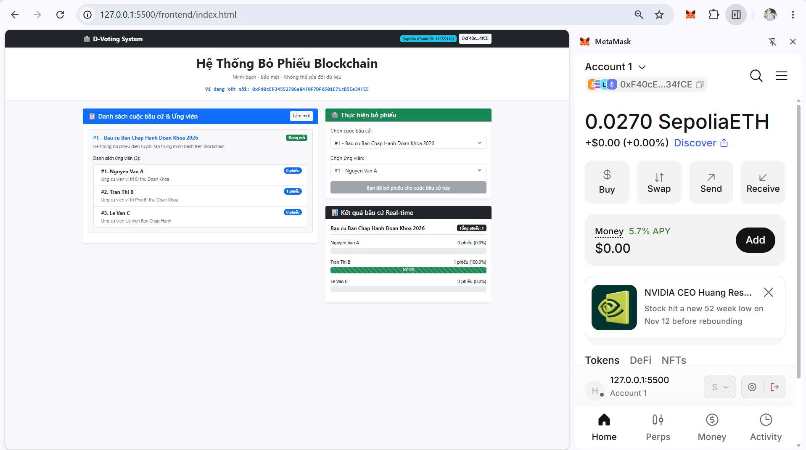
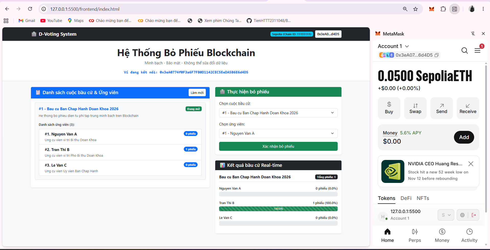
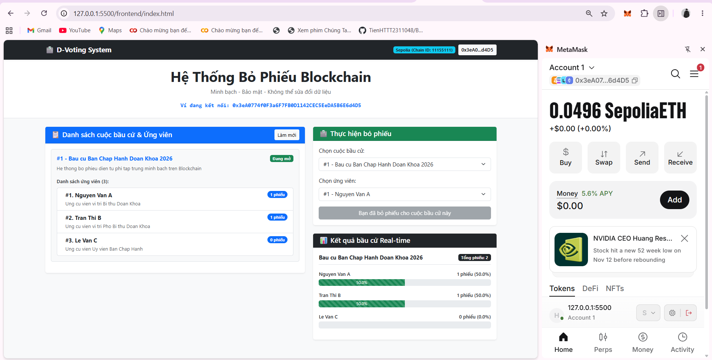
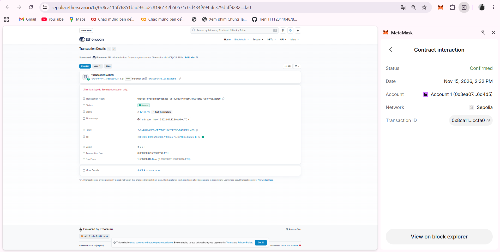

@'
# Báo Cáo Kiểm Thử Hệ Thống Bỏ Phiếu Phi Tập Trung (D-Voting)

- **Mạng thử nghiệm:** Ethereum Sepolia Testnet (Chain ID: `11155111`)
- **Địa chỉ Smart Contract:** `0x5D6F0452b485603E99a86Be797D39196C86a26FB`
- **Người thực hiện kiểm thử:** Trần Thị Ngọc Mỹ

## 1. Bảng tổng hợp kết quả kiểm thử (Test Cases)

| Mã TC | Kịch bản kiểm thử | Kết quả kỳ vọng | Kết quả thực tế | Bằng chứng xác thực |
| :--- | :--- | :--- | :--- | :--- |
| **TC-01** | Kết nối ví MetaMask mạng Sepolia (`0x3eA07...6d4D5`) | Hiển thị đúng địa chỉ ví, mạng Sepolia và danh sách ứng viên | **Đạt (Pass)** | `images/tc01_connect.png` |
| **TC-02** | Bỏ phiếu hợp lệ cho ứng viên *#1 - Nguyen Van A* | Giao dịch thành công, tăng 1 phiếu cho ứng viên #1 | **Đạt (Pass)** | Tx Hash: `0x8ca115f76851b5d93cb2c8196142b50571c0cf434f9945fc379d5ff9282ccfa0` |
| **TC-03** | Cập nhật kết quả Real-time đa cử tri | Tổng phiếu = 2, tỷ lệ chia đều 50.0% - 50.0% | **Đạt (Pass)** | `images/tc03_vote_result.png` |
| **TC-04** | Chống bỏ phiếu trùng trên giao diện (ví `0xF40cE...34fCE` và `0x3eA07...6d4D5`) | Nút bỏ phiếu tự động khóa sau khi cử tri hoàn tất bỏ phiếu | **Đạt (Pass)** | `images/tc04_prevent_double_vote.png` |
| **TC-05** | Kiểm tra tính minh bạch giao dịch trên Etherscan | Ghi nhận trạng thái `Success` tại Block `12138770` | **Đạt (Pass)** | [Xem trên Sepolia Etherscan](https://sepolia.etherscan.io/tx/0x8ca115f76851b5d93cb2c8196142b50571c0cf434f9945fc379d5ff9282ccfa0) |

## 2. Hình ảnh minh chứng thực tế

### TC-01: Kết nối ví MetaMask & Đọc dữ liệu đa cử tri

### TC-03: Bỏ phiếu hợp lệ & Cập nhật kết quả Real-time (50% - 50%)

### TC-04: Khóa nút bấm chống bỏ phiếu trùng trên giao diện

### TC-05: Xác thực giao dịch thành công trên Sepolia Etherscan

'@ | Set-Content -Path "docs\Bao_cao_Kiem_thu_DVoting.md" -Encoding UTF8